# Add a game

Add a game the catalog doesn't know, such as your own copy of a CD game with its user disk, and set it up yourself: group its disc and disks, name it, choose which disk goes in each drive, and play. Everything here is done from KairoTowns's own screens, and all of it is kept.

## 1. Add the disc and disks

Copy the game's CD image (CUE, CCD, MDS or ISO, with its track data) and its floppies (HDM, D77…) into your games folder (a folder of their own keeps them together), then open the library menu › **Refresh**. A game the catalog doesn't know is listed under its file names, one entry per disc or disk.

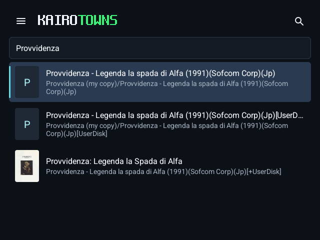

## 2. Group them into one game

Open the CD › **Game settings** (on a two-screen device, Game settings is on the second screen). Under **Library**, **Disks** shows the game's disks.

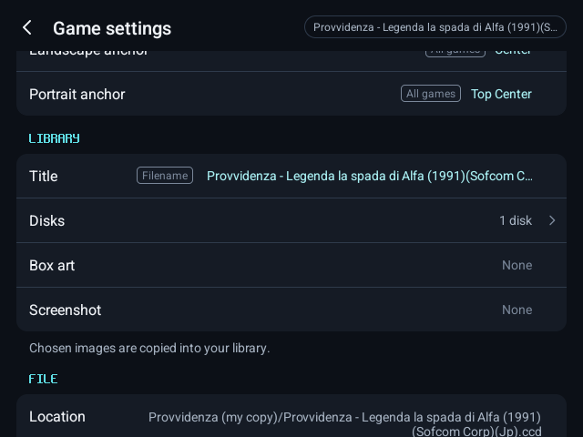

Switch on the game's other disks, such as its user disk. They leave the library list and become this game's disks; the row reads "2 disks".

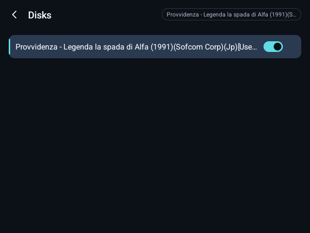

## 3. Name it

Under **Library**, **Title**: type the game's name and save. **Box art** and **Screenshot** take images from your device.

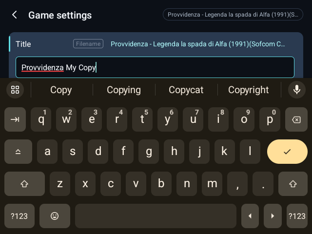

The library now lists it once, under its name.

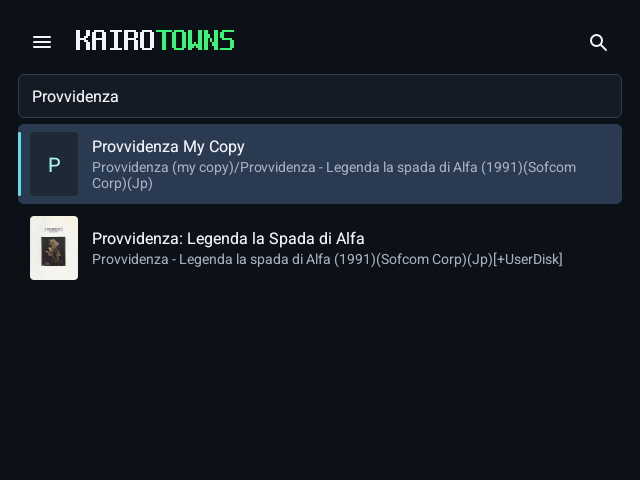

## 4. Choose its drives

The game starts from the disc you grouped the others on, in the CD-ROM. Under **Machine**, put its other disks where it expects them: here **Floppy A** holds the user disk.

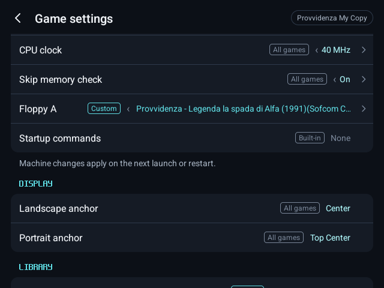

## 5. Firmware

FM Towns games need the machine's ROMs. Library menu › **Machine** › **Firmware** shows whether each is installed, and which are required; **Import all from a folder…** finds and imports them.

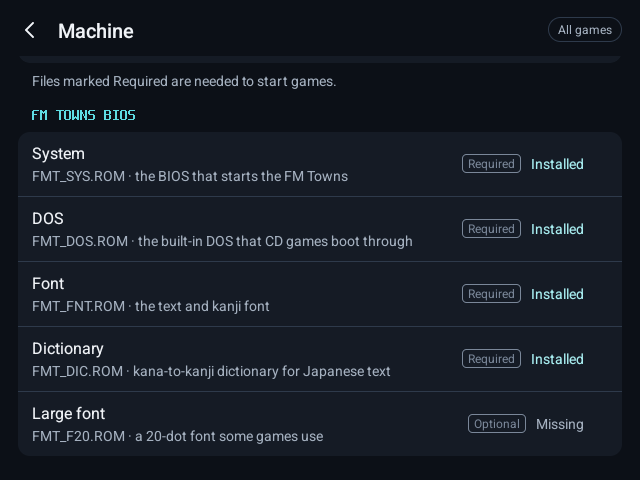

## 6. Configure

Everything else in Game settings (controls, memory, CPU clock, display) is kept for this game alone.

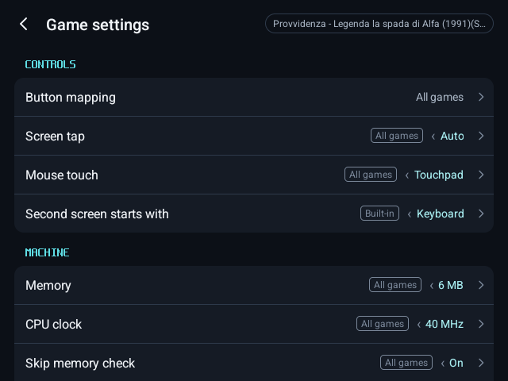

## 7. Play

Press **Play**.

In the menu, **Disks** shows each drive.

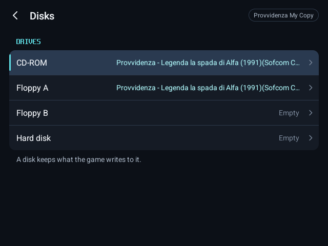

Each drive lists the game's disks first, under **This game**, for swapping when it asks.

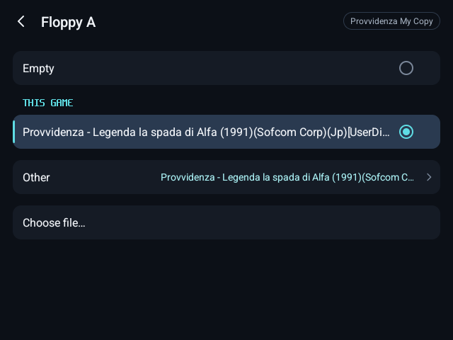

## 8. It is kept

Save your progress with **Save state**, as with any game. What the game writes to its disks, such as its user disk, is kept too.

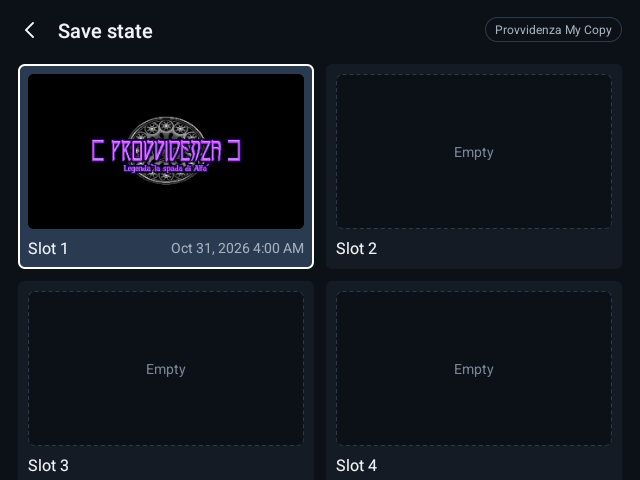

After closing and reopening KairoTowns, the game is still one game with its name, disks and settings, and **Load state** brings back your progress.

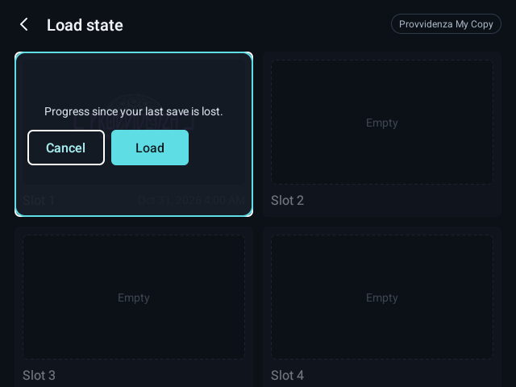
