# Create a game

Make a new game on a blank floppy disk: Towns OS formats it, and whatever you put on it (a program you write, a game's user disk, files you install) is kept as a game in your library. The Towns OS or application CD you boot from can stay wherever it is (for example in Download): the Disks page puts it in the CD-ROM from anywhere on the device.

## 1. Make a blank disk

Open the library menu › **Manage library**. Under **New game**, choose **Floppy disk · 1.2 MB · 2HD**. The hard disks (40, 100 and 240 MB SCSI) are made the same way; Towns OS's own hard disk setup prepares one.

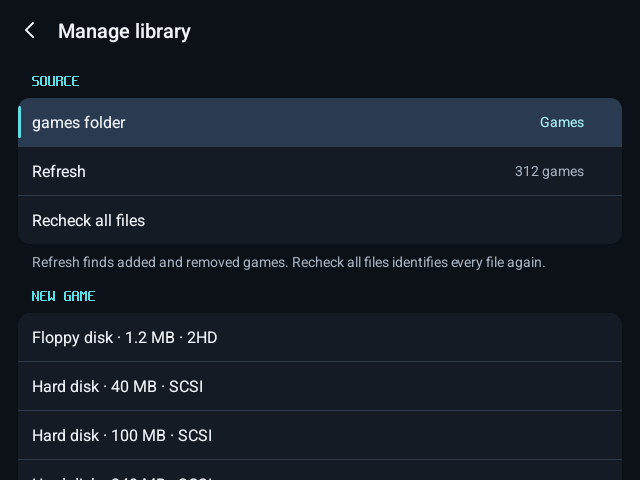

Name it and press **Create**.

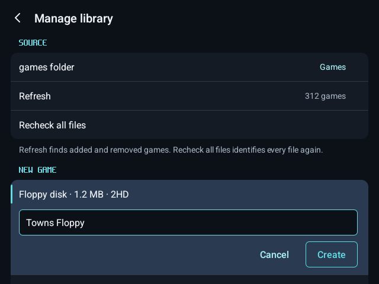

The blank disk is saved in your games folder, in a folder of its own, and listed as a game.

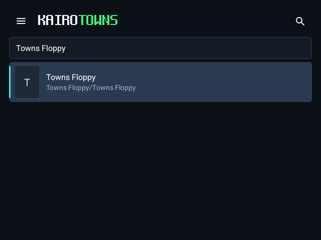

## 2. Start Towns OS with the new disk in its drive

Press **Play**. The blank disk is in Floppy A, and with nothing to start from the Towns says so (システムが違います).

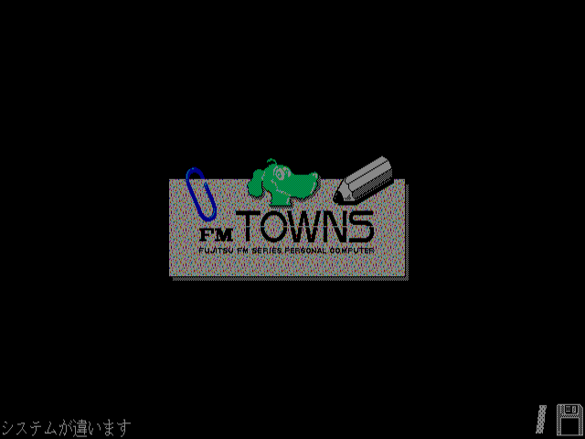

Open the menu › **Disks** › **CD-ROM** › **Choose file…** and pick a Towns OS CD, or an application CD that starts Towns OS (here F-BASIC386). A CD kept as a CUE sheet with its BIN goes in as an archive that holds both: a ZIP of the two files.

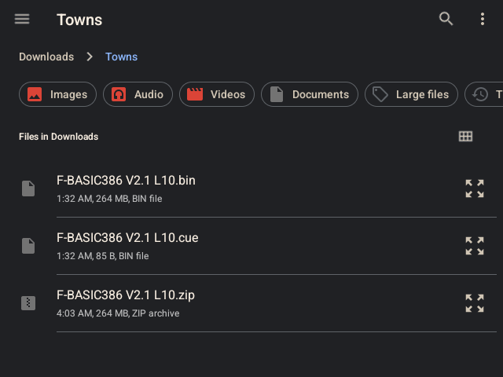

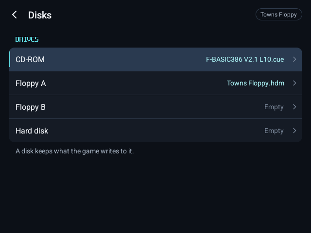

Towns OS starts from the CD.

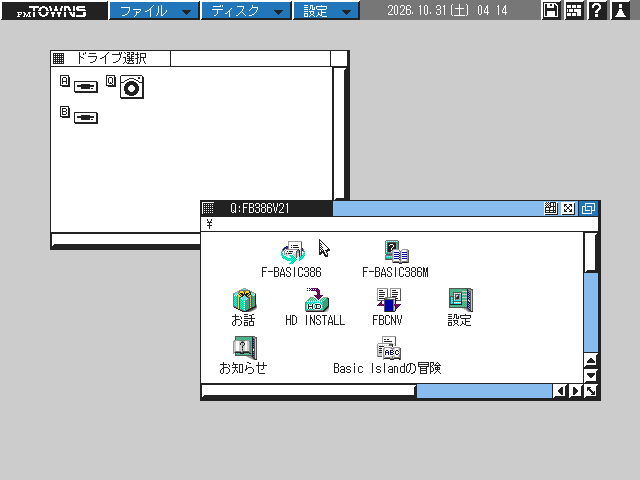

## 3. Format it

In Towns MENU, **ディスク** › **初期化** (Disk › Initialize): drive A, **1.2 MB [2HD]**, a name for the disk, then **実行** (Run) and **実行** again to confirm.

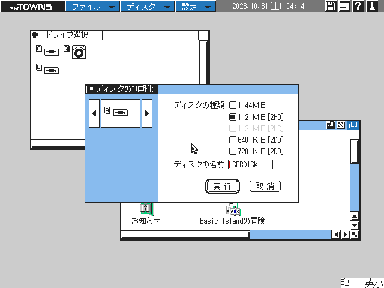

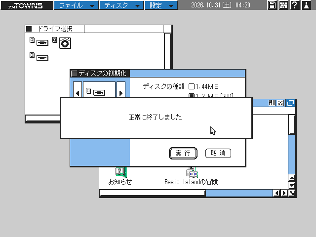

Double-tap drive A's icon to open it: an empty Towns disk.

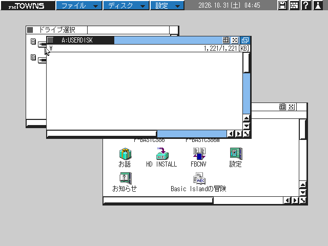

## 4. Put your game on it

Install to it or save to it from any Towns program. Here: start F-BASIC386 from the CD, type a program,

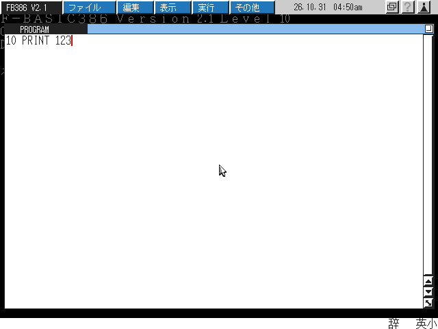

then **ファイル** › **保存** (File › Save) as `A:¥HELLO.BAS`.

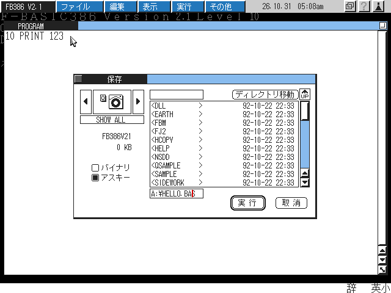

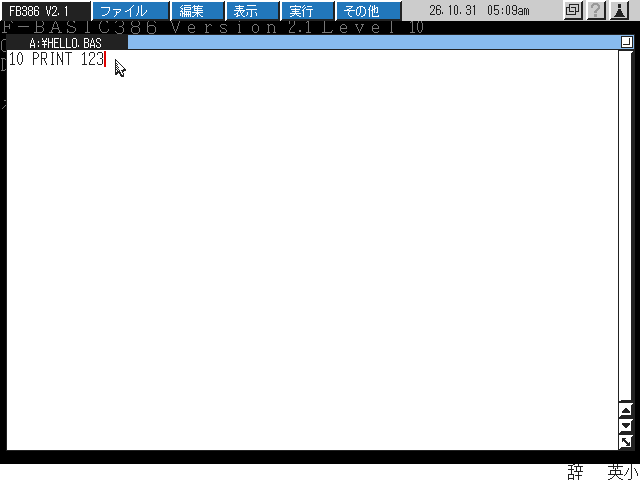

## 5. It is kept

The disk keeps what Towns OS and your programs write to it. After closing and reopening KairoTowns, the new game is still in the library, its disk still holds its files, and it plays like any other game.

